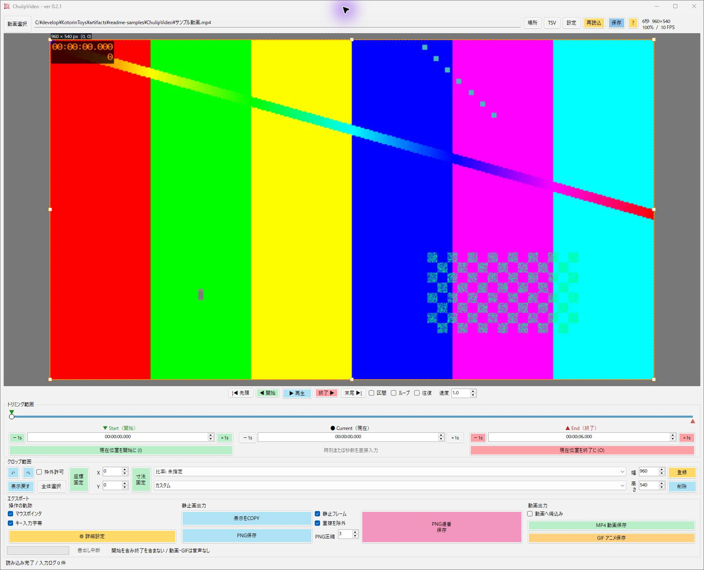
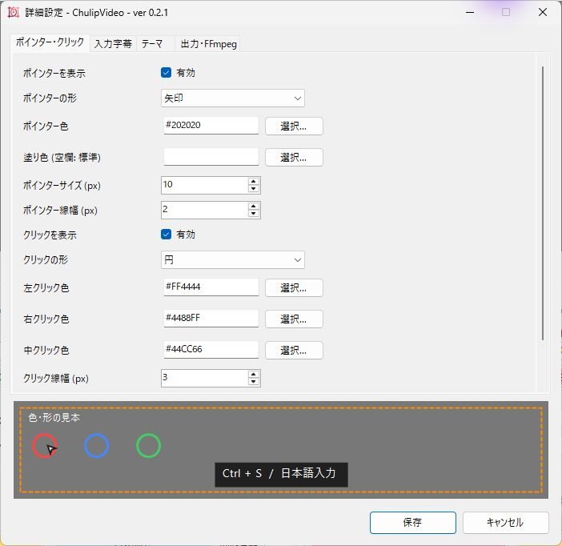
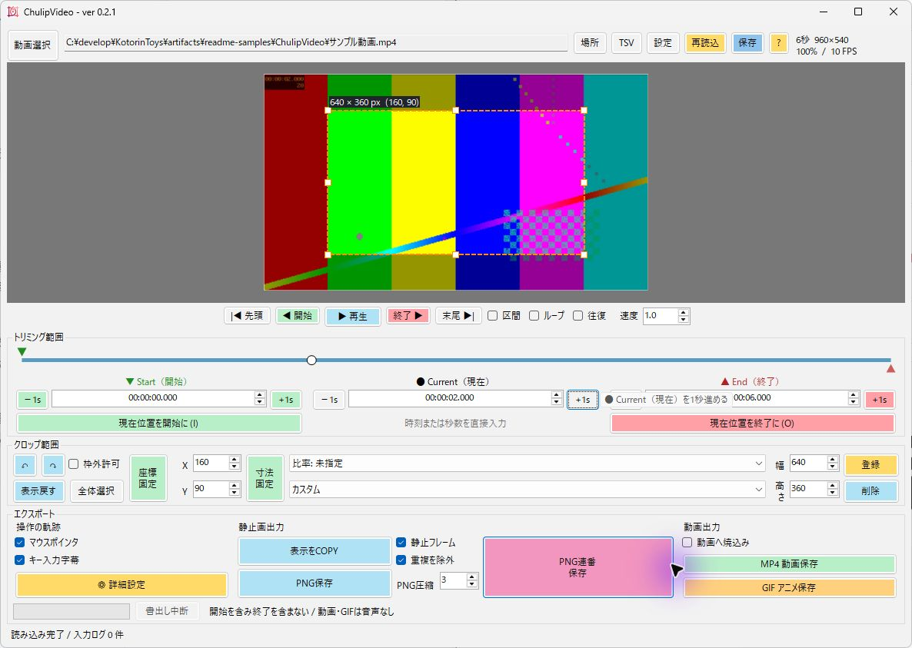
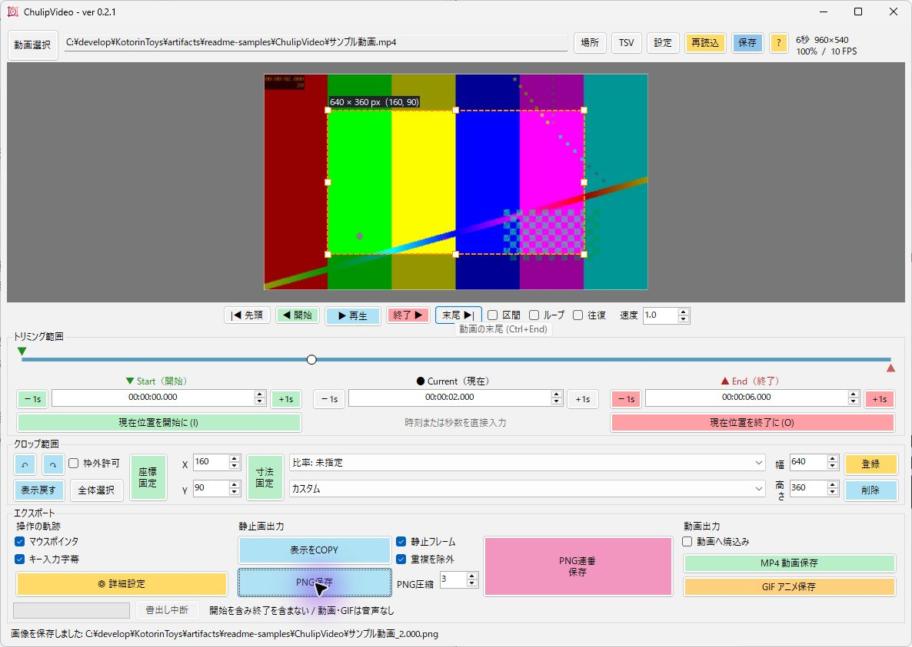
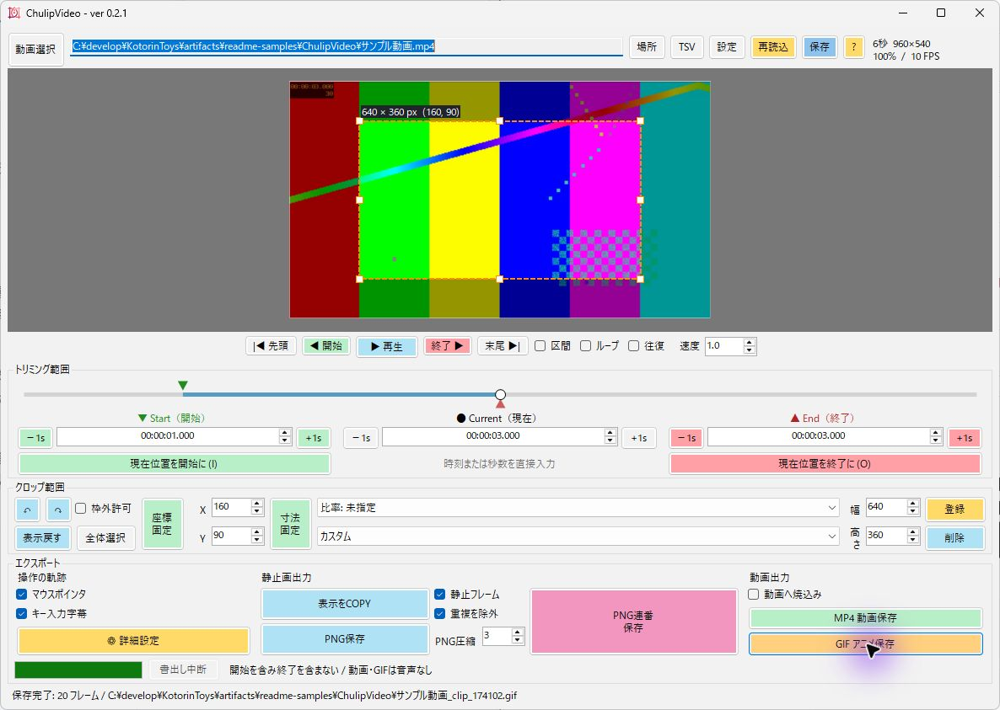

# ChulipVideo

ローカル動画のデコーダーはfile/pipeだけを許可し、ファイル内プレイリストからのHTTP等の接続を拒否します。インターネットの動画参照を含むファイルは対象外です。FFmpegは最新の信頼できる版を利用してください。この制限は未知のメディア脆弱性やOSサンドボックスを保証するものではありません。

動画から手順書用の画像を切り出す、C#/.NET 10 Windows Formsアプリです。Python版の編集・画像抽出機能を独立して移植しました。v0.2.0ではPython実画面とRust/Tauri試作を参考に、再生・トリム・クロップ・出力を一画面へまとめています。

## 主な機能

- 動画の再生・逆再生、速度変更、区間・ループ・往復再生。
- トリム、ピクセル単位のクロップ、拡大・パン、Undo/Redo、解像度プリセット。
- 現在画像のコピー・PNG保存、PNG連番、静止フレーム抽出・重複除外、MP4/GIF出力。
- 同名TSVからマウス・クリック・キー字幕を表示。TSV/SRT/VTT出力と映像への焼き込み。
- 動画別設定の保存とPython版設定の読み込み。
- 開発中のv0.2.2で追加（[操作ガイド](docs/guide.md)）:
  - 入力ログからの手順の自動抽出と、手順書エディター。Markdown・HTML・Word・PDFの手順書を、番号・枠・矢印の注釈付きで書き出す。
  - 時間帯を指定するマスク（モザイク・ぼかし・塗りつぶし）を、すべての出力にかける。
  - 静止判定の許容差（既定で圧縮ノイズを許容）。
  - ポインターの平滑化、クリック位置への自動ズーム、操作のない区間のカット・早送り。
  - 複数区間・マーカーと一括書き出し。
  - Windows標準OCRによる対象名の読み取り・マスク候補。
  - AI（Claude、既定は無効・送信前に確認）による説明文と、音声合成によるナレーション。

録画はCapchunScreen、外部ウィンドウ操作はChunapToolを利用する構成です。ChulipVideoには含めていません。

## 配布版

[C#版GitHub Releases](https://github.com/KotorinChunChun/ChulipVideo-CSharp/releases)の`ChulipVideo-0.2.1-setup.exe`で利用者単位に導入できます。KotorinToys 0.1.2以降からの導入・更新・削除にも対応します。設定・動画・画像は保持します。[導入ガイド](docs/install.md)を確認してください。既存のZIPは展開して実行する方式として保持します。.NET Desktop Runtimeを同梱し、FFmpegは別途設定します。

## 1. 動画を開く

「動画選択」でPC内の動画を選ぶか、動画を画面へドロップします。映像と動画の長さ・サイズが表示され、下部に「読み込み完了」と出れば準備完了です。「再生」で映像を確認します。



## 2. 表示や出力を設定する

上部の「設定」から、ポインター・クリック、入力字幕、テーマ、出力・FFmpegを設定できます。ポインターや字幕の表示には、動画に対応する入力履歴TSVが必要です。色や形は画面下部の見本で確認し、「保存」で適用します。



## 3. 時刻と切り出す範囲を決める

「Current（現在）」に欲しい場面の時刻を入力します。プレビューをドラッグして枠を作るか、「クロップ範囲」のX・Y・幅・高さで切り出す範囲を指定してください。画像は枠内だけが保存されます。

例では2秒の場面から、X=160・Y=90を左上とする640×360ピクセルの画像を切り出します。やり直すときは「全体選択」や元に戻すボタンを使います。



## 4. 画像を保存する

「PNG保存」で現在の1枚を保存します。下部に「画像を保存しました」と保存先が表示されたら完了です。「表示をCOPY」なら、画像を文書などへ貼り付けられます。

複数の画像が必要な場合は、StartとEndを指定して「PNG連番保存」を使います。動きのある場面もすべて出力したいときは「静止フレーム」と「重複を除外」をOFFにしてください。



## 5. 短い動画やGIFを作る

StartとEndで区間を指定し、「MP4動画保存」または「GIFアニメ保存」を押します。保存先を選び、下部の進捗が完了するまで待ちます。例では1秒から3秒までの20フレームをGIFへ出力しています。動画・GIFの音声は出力しません。



## よく使う操作

| 操作 | キー |
| --- | --- |
| 動画を開く | Ctrl + O |
| 再生・停止 | Space |
| 0.1秒移動 | ← / → |
| 現在の画像をPNG保存 | Ctrl + S |
| 現在の画像をコピー | Ctrl + C |
| クロップを元に戻す・やり直す | Ctrl + Z / Ctrl + Y |
| 現在位置を区間の開始・終了にする | I / O |

## 困ったとき

- **動画を開けない** — FFmpegの設定と、PC内に動画ファイルがあることを確認してください。インターネット上の動画を参照するプレイリストは扱いません。
- **PNG連番が0枚になる** — 動きのある動画では「静止フレーム」をOFFにしてください。
- **字幕やポインターが出ない** — 対応する入力履歴TSVと、表示チェックを確認してください。
- **編集を後で続けたい** — 上部の「保存」で動画別設定を保存してください。詳細は[操作ガイド](docs/guide.md)にあります。

録画にはCapchunWindow、別ウィンドウの位置調整にはChunapToolを利用できます。

## 開発版の起動

Windowsと.NET 10 SDK、FFmpegが必要です。PowerShell 7で実行します。

```powershell
cd C:\develop\KotorinToys\tools\ChulipVideo
./dev/scripts/start.ps1
```

この開発環境では移植元にあったFFmpegを`.local/ffmpeg.exe`へ複製しています。この場所はDebugビルドだけが自動検索し、配布版は参照しません。Python本体への実行時依存はありません。別環境では「設定」でFFmpeg実行ファイルを指定するか、`CHULIPVIDEO_FFMPEG`環境変数にパスを設定してください。

[操作・設定・開発手順](docs/guide.md) / [配布ZIPの作成手順](docs/release.md) / [v0.2.0 要求](dev/history/v0.2.0/v0.2.0-req.md) / [実装・検証報告](dev/history/v0.2.0/v0.2.0-imp.md)

## KotorinToys管理連携（2026-10-15追加）

本体の一覧からの開発版起動・既存画面表示・状態確認・正常停止に対応しています。単体ZIPの配布と本体の正式導入・更新カタログは別管理です。[管理連携と検証用起動](docs/kotorintoys-integration.md)を参照してください。
